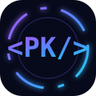

<!-- 01 · HERO -->

<!-- 02 · TYPING INTRO -->

  

<!-- 03 · INTRODUCTION -->

**Full Stack Developer &nbsp;·&nbsp; Software Engineer &nbsp;·&nbsp; Exploring Agentic AI**
Bangalore, India

I build modern full-stack products with secure APIs, role-based access and database-backed workflows,
and I'm now exploring how to turn them into intelligent, agent-driven applications.

<!-- 04 · SOCIAL LINKS -->

  
  
  
  
  
  

<!-- 05 · VISITOR COUNTER -->

  

 

<!-- 06 · ABOUT ME -->
## 👨‍💻 About Me

<table>
<tr>
<td width="58%" valign="top">

I'm an entry-level **Software Developer** with a **B.Tech in Computer Science and Engineering (Cyber Security)**.
I build full-stack applications, REST APIs, authentication systems, role-based access control and database-backed products.

- 🏢 **Full Stack Developer Intern** at **A2Infotech Pvt. Ltd.** (Jan 2026 – Mar 2026)
- 🧩 **260+** problems solved on LeetCode, **500+** on GeeksforGeeks
- 🔐 Comfortable with JWT auth, RBAC and input validation
- 🤝 Open to collaborating on **MERN, Next.js, backend and AI projects**

</td>
<td width="42%" valign="middle">

</td>
</tr>
</table>

 

<!-- 07 · CURRENTLY BUILDING -->
## 🚧 Currently Building

### 🤖 AI Automation Platform — Custom AI Agents Builder

An AI-powered automation platform where users can chat with AI, build **custom AI agents**, automate workflows, and connect those agents to external tools.

<table>
<tr>
<td width="50%" valign="top">

**Planned features**

- Interactive AI chat interface
- Custom AI agents builder
- AI-powered workflow automation
- Model Context Protocol (MCP) integration
- Intelligent agent workflows
- Dashboard
- Subscription and payment integration

</td>
<td width="50%" valign="top">

**Tech stack**

</td>
</tr>
</table>

> 🔧 *Work in progress. Not yet released.*

 

<!-- 08 · TECH STACK -->
## ⚡ Technology Stack

| | |
|:--|:--|
| **Languages** |  &nbsp; |
| **Frontend** |  &nbsp; |
| **Backend** |       |
| **Database** |  &nbsp; |
| **Tools** |     |
| **AI** *(exploring)* |        |
| **DevOps** *(learning)* |  |

 

<!-- 09 · FEATURED PROJECTS -->
## 🚀 Featured Projects

<table>
<tr>
<td width="33%" valign="top">

### 🕒 QueueLess
*Local Services Booking & Virtual Queue Platform*

- Multi-role marketplace
- Appointment booking
- Virtual queue management
- Atomic token allocation
- Commission tracking

`Next.js` `TypeScript` `PostgreSQL` `Prisma` `Tailwind CSS` `Zod` `Vitest` `Playwright`

</td>
<td width="33%" valign="top">

### 🔨 QuickHammer
*Full Stack Auction Bidding Platform*

- Online auction platform
- Bidding system
- Role-based authorization
- Automated auction management
- Admin dashboard

`React` `Redux Toolkit` `Node.js` `Express` `MongoDB` `JWT` `Cloudinary`

</td>
<td width="33%" valign="top">

### 🩺 ZEE Care
*Doctor Appointment Management System*

- Appointment booking
- Patient and admin authentication
- Doctor management
- Admin dashboard

`MongoDB` `Express` `React` `Node.js` `JWT` `Cloudinary`

</td>
</tr>
</table>

  
  

 

<!-- 10 · CURRENTLY LEARNING -->
## 🧠 Currently Learning: Agentic AI

Still learning, separate from the stack I've shipped with above.

  
  
  
  
  
  
  
  
  

 

<!-- 11 · CONTRIBUTION SNAKE -->
## 🐍 Contribution Snake

  <picture>
    <source media="(prefers-color-scheme: dark)" srcset="https://raw.githubusercontent.com/premkr7370/premkr7370/output/github-snake-dark.svg" />
    <source media="(prefers-color-scheme: light)" srcset="https://raw.githubusercontent.com/premkr7370/premkr7370/output/github-snake.svg" />
    
  </picture>

 

<!-- 12 · GITHUB STATS -->
## 📊 GitHub Statistics

 

<!-- 13 · PROBLEM SOLVING -->
## 🏆 Problem Solving

<table>
<tr>
<td align="center" width="50%">

</td>
<td align="center" width="50%">

</td>
</tr>
</table>

Data Structures & Algorithms · OOP · NPTEL certified in OOP and Cloud Computing & Distributed Systems

 

<!-- 14 · RESUME + PORTFOLIO BUTTONS -->

### 📄 Let's work together

 

<!-- 15 · FOOTER -->

# premkr7370

