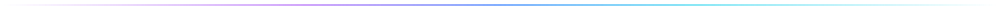
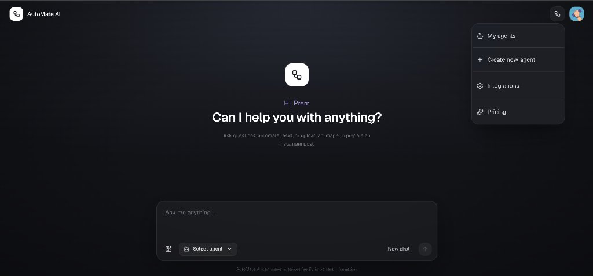
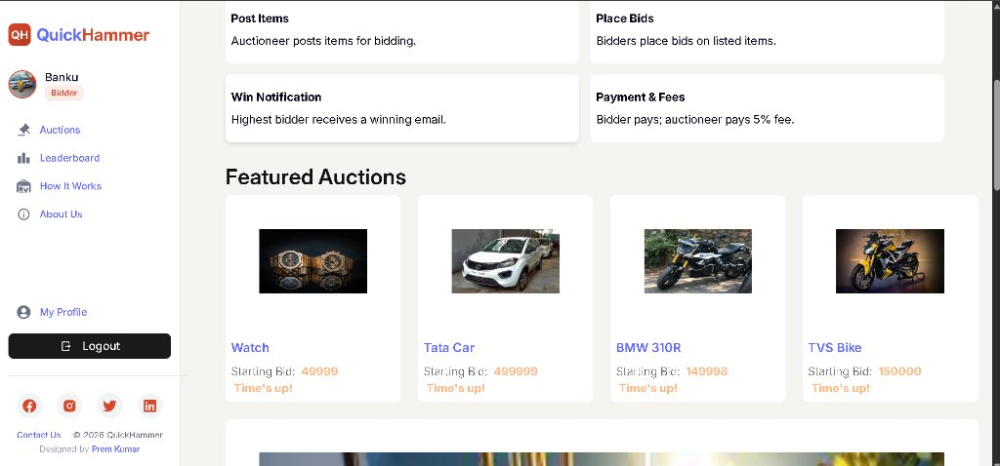
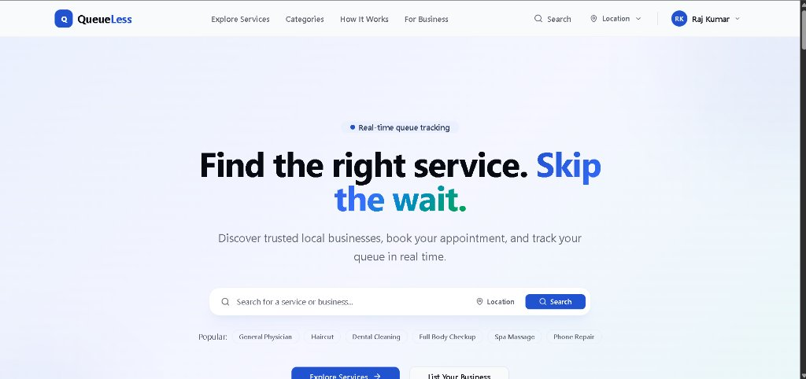
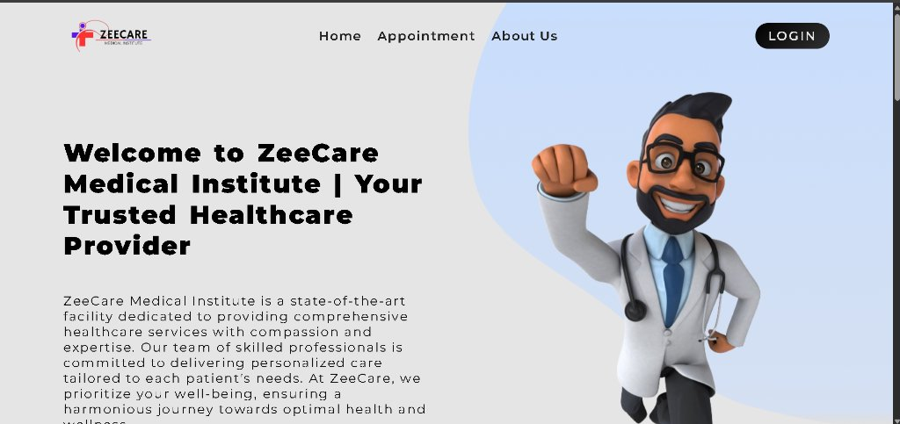
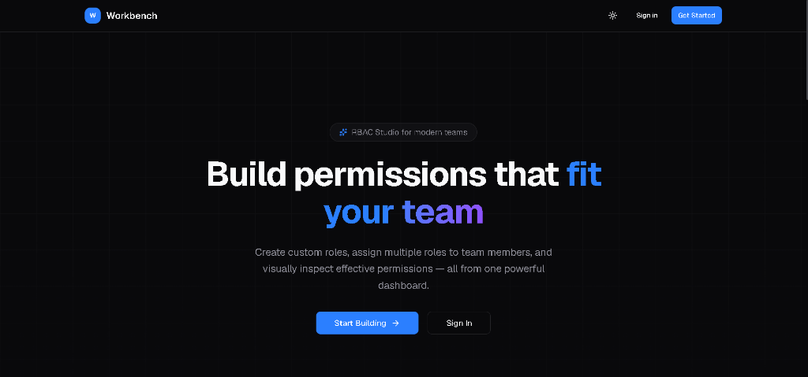

<!-- ═══════════════════════════════════════════════════════════════
     PREM KUMAR — GitHub Profile README
     Premium Software Developer Portfolio
     ═══════════════════════════════════════════════════════════════ -->

<!-- 01 ─ HERO BANNER -->

<!-- 02 ─ TYPING INTRO -->

  
   
  📍 Bangalore, India &nbsp;&nbsp;&nbsp;·&nbsp;&nbsp;&nbsp; Full Stack AI Developer &nbsp;|&nbsp; Software Developer

 

<!-- 03 ─ SOCIAL LINKS -->

  &nbsp;
  &nbsp;
  &nbsp;
  &nbsp;
  &nbsp;
  

<!-- 04 ─ VISITOR COUNTER -->

  

 

<!-- ═══════════════════════════════════════════════════════════════ -->
<!-- 05 ─ ABOUT ME                                                  -->
<!-- ═══════════════════════════════════════════════════════════════ -->

## About Me

<table>
  <tr>
    <td width="58%" valign="top">
      

        Software Developer with a <strong>B.Tech in Computer Science &amp; Engineering (Cyber Security)</strong> (2022–2026 · CGPA: 7.6) from IES College of Technology, Bhopal. Recently completed a Full Stack Developer internship at <strong>A2Infotech Pvt. Ltd.</strong> (Jan 2026 – Mar 2026).
      

      <ul>
        <li>Building production-ready applications with <strong>React.js, Next.js, Node.js, Express.js</strong> and <strong>MongoDB/PostgreSQL</strong></li>
        <li>Experienced with <strong>REST API development</strong>, JWT authentication, OAuth and <strong>role-based access control</strong></li>
        <li>Working with <strong>Prisma ORM</strong>, Zod validation and database-backed workflows</li>
        <li>Building <strong>Full Stack AI &amp; Web applications</strong> — LLMs, LangChain, LangGraph, RAG, Embeddings, MCP and vector databases</li>
        <li><strong>260+</strong> LeetCode problems solved &nbsp;·&nbsp; <strong>500+</strong> GeeksforGeeks problems solved</li>
      </ul>
    </td>
    <td width="42%" valign="middle">
      
    </td>
  </tr>
</table>

 

<!-- ═══════════════════════════════════════════════════════════════ -->
<!-- 06 ─ TECHNOLOGY STACK                                          -->
<!-- ═══════════════════════════════════════════════════════════════ -->

## Technology Stack

<table>
  <tr>
    <td align="right" width="160"><strong>Languages</strong></td>
    <td>
      &nbsp;&nbsp;
      
    </td>
  </tr>
  <tr>
    <td align="right"><strong>Frontend</strong></td>
    <td>
      
    </td>
  </tr>
  <tr>
    <td align="right"><strong>Backend</strong></td>
    <td>
      &nbsp;&nbsp;
      &nbsp;
      &nbsp;
      &nbsp;
      &nbsp;
      
    </td>
  </tr>
  <tr>
    <td align="right"><strong>Database & ORM</strong></td>
    <td>
      &nbsp;&nbsp;
      
    </td>
  </tr>
  <tr>
    <td align="right"><strong>Tools & Testing</strong></td>
    <td>
      &nbsp;&nbsp;
      &nbsp;
      &nbsp;
      &nbsp;
      
    </td>
  </tr>
  <tr>
    <td align="right"><strong>AI & LLM</strong></td>
    <td>
      &nbsp;
      &nbsp;
      &nbsp;
      &nbsp;
      &nbsp;
      &nbsp;
      
    </td>
  </tr>
  <tr>
    <td align="right"><strong>CS Fundamentals</strong></td>
    <td>
      &nbsp;
      &nbsp;
      &nbsp;
      &nbsp;
      &nbsp;
      
    </td>
  </tr>
</table>

 

<!-- ═══════════════════════════════════════════════════════════════ -->
<!-- 07 ─ FEATURED PROJECTS                                         -->
<!-- ═══════════════════════════════════════════════════════════════ -->

## Featured Projects

<!-- ─── PROJECT 1: AutoMate AI ─── -->

<table>
  <tr>
    <td width="50%">
      
    </td>
    <td width="50%" valign="top">
      <h3>AutoMate AI</h3>
      
<em>Full-Stack AI Productivity Platform</em>

      
An AI productivity platform for creating, managing, and interacting with intelligent agents. Integrates AI models, authentication, payments, and external services.

      

        &nbsp;
        &nbsp;
        &nbsp;
        &nbsp;
        &nbsp;
        &nbsp;
        &nbsp;
        &nbsp;
        &nbsp;
        
      

      

        &nbsp;
        
      

    </td>
  </tr>
</table>

 

<!-- ─── PROJECT 2: QuickHammer ─── -->

<table>
  <tr>
    <td width="50%" valign="top">
      <h3>QuickHammer</h3>
      
<em>Full-Stack Online Auction Bidding Platform</em>

      
Auctioneers list and schedule items, bidders place bids, administrators manage auction activities, review commission payment proofs, and monitor platform summaries.

      

        &nbsp;
        &nbsp;
        &nbsp;
        &nbsp;
        &nbsp;
        &nbsp;
        &nbsp;
        &nbsp;
        
      

      

        &nbsp;
        
      

    </td>
    <td width="50%">
      
    </td>
  </tr>
</table>

 

<!-- ─── PROJECT 3: QueueLess ─── -->

<table>
  <tr>
    <td width="50%">
      
    </td>
    <td width="50%" valign="top">
      <h3>QueueLess</h3>
      
<em>Smart Local Services Marketplace with Virtual Queues</em>

      
Customers discover businesses, book services, track queue positions, and avoid long waiting times. Features multi-role marketplace, appointment booking, time-slot conflict detection, and atomic token allocation.

      

        &nbsp;
        &nbsp;
        &nbsp;
        &nbsp;
        &nbsp;
        &nbsp;
        &nbsp;
        
      

      

        &nbsp;
        
      

    </td>
  </tr>
</table>

 

<!-- ─── PROJECT 4: ZeeCare ─── 

<table>
  <tr>
    <td width="50%" valign="top">
      <h3>ZeeCare</h3>
      
<em>Doctor Appointment Management System</em>

      
Patients register, browse doctors, request appointments, and send messages. Administrators manage doctors, appointments, and messages through a dedicated dashboard.

      

        &nbsp;
        &nbsp;
        &nbsp;
        &nbsp;
        &nbsp;
        &nbsp;
        
      

      

        &nbsp;
        
      

    </td>
    <td width="50%">
      
    </td>
  </tr>
</table>

 
-->
<!-- ─── PROJECT 5: Workbench – RBAC Studio ─── 

<table>
  <tr>
    <td width="50%">
      
    </td>
    <td width="50%" valign="top">
      <h3>Workbench — RBAC Studio</h3>
      
<em>Role-Based Access Control Management Platform</em>

      
Administrators create roles, manage permissions, assign multiple roles to team members, and visualize effective permissions from one powerful dashboard.

      

        &nbsp;
        &nbsp;
        
      

      

        &nbsp;
        
      

    </td>
  </tr>
</table>
-->

   
  

 

<!-- ═══════════════════════════════════════════════════════════════ -->
<!-- 08 ─ GITHUB ANALYTICS                                          -->
<!-- ═══════════════════════════════════════════════════════════════ -->

## GitHub Analytics

  
  

   

  

   

  

 

<!-- ═══════════════════════════════════════════════════════════════ -->
<!-- 09 ─ CONTRIBUTION SNAKE                                        -->
<!-- ═══════════════════════════════════════════════════════════════ 

## Contribution Snake

  <picture>
    <source media="(prefers-color-scheme: dark)" srcset="https://raw.githubusercontent.com/premkr7370/premkr7370/output/github-snake-dark.svg" />
    <source media="(prefers-color-scheme: light)" srcset="https://raw.githubusercontent.com/premkr7370/premkr7370/output/github-snake.svg" />
    
  </picture>

 

-->
<!-- ═══════════════════════════════════════════════════════════════ -->
<!-- 10 ─ PROBLEM SOLVING                                           -->
<!-- ═══════════════════════════════════════════════════════════════ -->

## Problem Solving

<table>
  <tr>
    <td align="center" width="50%">
      
        
      <!--  -->
    </td>
    <td align="center" width="50%">
      
        
      Data Structures & Algorithms · OOP · Operating Systems · Computer Networks · DBMS
    </td>
  </tr>
</table>

 

<!-- ═══════════════════════════════════════════════════════════════ -->
<!-- 11 ─ RESUME                                                    -->
<!-- ═══════════════════════════════════════════════════════════════ -->

## Resume

  

 

<!-- ═══════════════════════════════════════════════════════════════ -->
<!-- 12 ─ MUSIC                                                     -->
<!-- ═══════════════════════════════════════════════════════════════ 

  <h3>🎧 Ambient Music</h3>
  
<em>Listen to relaxing instrumental music while exploring this portfolio:</em>

  
    
  Tip: Click to open and stream the track directly in your browser.

 

-->

<!-- ═══════════════════════════════════════════════════════════════ -->
<!-- 13 ─ LET'S CONNECT                                             -->
<!-- ═══════════════════════════════════════════════════════════════ -->

  <h3>Let's Work Together</h3>
  &nbsp;
  &nbsp;
  

 

<!-- 14 ─ FOOTER -->

